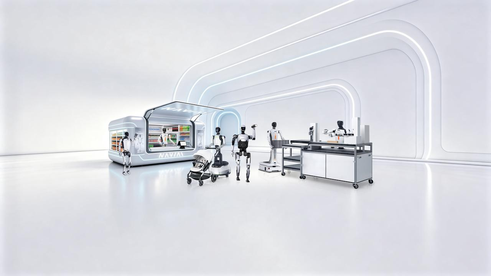

------

浙江人形机器人创新中心有限公司（简称“浙江人形”）成立于2023年12月，由熊蓉教授及团队携手多家知名产业伙伴共同创立。公司聚焦具身智能大小脑及人形机器人关键技术攻关与产品研发，围绕感知、决策、规划、控制等关键环节开展全栈自主研发，形成涵盖算法模型、机器人整机、核心部件及开发工具链的产品体系。

Zhejiang Humanoid Robotics Innovation Center Co., Ltd. (hereinafter referred to as “Zhejiang Humanoid”) was established in December 2023 by Professor Xiong Rong and her team in collaboration with several renowned industry partners. The company focuses on the development of embodied AI brain and cerebellum models, as well as key humanoid robotics technologies and products. It pursues full-stack in-house R&D across key areas including perception, decision-making, planning, and control, and has established a product portfolio spanning algorithms and models, complete robotic systems, core components, and development toolchains.

2024年3月，浙江人形发布首代人形机器人样机“领航者1号”，实现稳定行走与全身协调运动；同年8月，推出具备精准技能作业能力的“领航者2号”，推动机器人从运动控制向精细操作能力拓展。

In March 2024, Zhejiang Humanoid unveiled its first-generation humanoid robot prototype, “Navigator No. 1,” achieving stable walking and coordinated full-body movement. In August of the same year, the company introduced “Navigator No. 2,” featuring precise task execution capabilities, advancing the development of humanoid robots from motion control toward fine manipulation.

在持续研发与技术积累的基础上，浙江人形构建了SPIRE具身智能技术体系、NAVIAI硬件产品体系和EvoStack软件工具链，形成软硬件协同的全栈技术体系。目前，公司已推出NAVIAI WA1、NAVIAI WA2轮臂人形机器人及NAVIAI i3全地形多功能双足机器人等产品，满足不同场景下的运动控制、柔性操作与精准作业需求。

Building on continuous R&D and accumulated technological expertise, Zhejiang Humanoid has developed the SPIRE embodied AI technology framework, the NAVIAI hardware product portfolio, and the EvoStack software toolchain, establishing a full-stack technology system that integrates software and hardware. The company has launched products including the NAVIAI WA1 and NAVIAI WA2 wheeled humanoid robots, as well as the NAVIAI i3 all-terrain multifunctional bipedal robot, addressing the needs for motion control, flexible manipulation, and precision operations across diverse scenarios.

浙江人形面向工业、服务、教育、数据采集等领域，持续推进具身智能机器人的技术验证与产业应用，已在工业制造、物流搬运、商业零售、科研教育等多个场景开展应用实践，并与多家产业合作伙伴开展合作，推动机器人技术在真实场景中的应用。

Zhejiang Humanoid is advancing the technological validation and industrial application of embodied AI robots across industrial, service, education, and data collection sectors. Its robots have been deployed in practical applications spanning industrial manufacturing, logistics and material handling, commercial retail, and scientific research and education. The company also collaborates with a range of industry partners to promote the adoption of robotic technologies in real-world environments.
